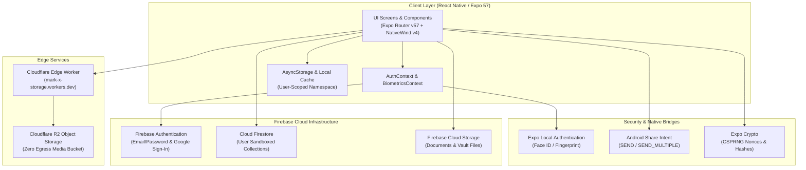

<div align="center">


# Mark-X

### The Executive Cloud Vault, Markdown Studio & Inspiration OS

[](https://docs.expo.dev/)
[](https://reactnative.dev/)
[](https://react.dev/)
[](https://www.typescriptlang.org/)
[](https://firebase.google.com/)
[](https://workers.cloudflare.com/)
[](https://www.nativewind.dev/)
[](./LICENSE)

<p align="center">
  <a href="#-about-mark-x">About</a> •
  <a href="#-core-features--app-tour">Core Features</a> •
  <a href="#-system-architecture">Architecture</a> •
  <a href="#-tech-stack">Tech Stack</a> •
  <a href="#-project-directory-structure">Directory Structure</a> •
  <a href="#-step-by-step-installation-guide">Installation</a> •
  <a href="#-building-native-apks">Building APKs</a> •
  <a href="#-license">License</a>
</p>

</div>

---

## 📖 About Mark-X

**Mark-X** is an executive-grade, unified personal productivity and cloud vault application built for **Android, iOS, and Web**. Engineered with a mobile-first philosophy, Mark-X bridges the gap between high-speed document cloud storage, intelligent markdown note-taking, a Pinterest-inspired visual inspiration board, and enterprise-grade hardware biometrics.

Whether you are archiving mission-critical documents, drafting structured thoughts in markdown with live previews, organizing visual media into collections, or locking private assets behind a dedicated passcode vault, Mark-X delivers a unified, encrypted, and ultra-fluid experience.

### Why Mark-X?

- ⚡ **Zero-Latency Interactions:** Built with Expo SDK 57, React Native 0.86, and React 19 Compiler optimizations.
- 🛡️ **Defense-in-Depth Security:** Hardware biometric authentication (Face ID / Android Fingerprint), encrypted local storage, and granular Firestore/Storage security rules.
- ☁️ **Dual-Engine Cloud Storage:** High-availability file distribution combining **Firebase Cloud Storage** and high-throughput **Cloudflare R2** via an edge Worker proxy.
- 🎨 **Modern Executive Aesthetic:** Styled with NativeWind v4 (Tailwind CSS 3.4), custom dark-mode typography (Outfit, Anton), and smooth haptic feedback.
- 📲 **Native Platform Integration:** Deep OS integrations including Android Share Sheet receiver (`SEND` / `SEND_MULTIPLE`), Camera capture, and background sync services.

---

## 📱 Core Features & App Tour

```
┌─────────────────────────────────────────────────────────────────────────────┐
│                               MARK-X ECOSYSTEM                              │
├──────────────┬──────────────┬──────────────┬──────────────┬─────────────────┤
│ 📂 Drive     │ 📝 Notes     │ 🖼️ Gallery   │ 🔒 Secret    │ 🛡️ Security     │
│ Cloud Files, │ Markdown,    │ Masonry,     │ Passcode PIN │ Face ID / Touch │
│ Folders &    │ Live Format, │ Video Cache, │ Vault & Hide │ Fleet Device    │
│ Share Intent │ Autosave     │ Collections  │ Private Media│ Management      │
└──────────────┴──────────────┴──────────────┴──────────────┴─────────────────┘
```

### 1. 📂 Executive Cloud & Document Drive
* **Hierarchical File Management:** Create folders, nested directories, breadcrumb navigation, and seamlessly move or rename files.
* **Universal File Preview Engine:** Native inline previews for PDFs ([`DrivePdfViewer`](./src/components/drive/DrivePdfViewer.tsx)), videos with hardware acceleration (`expo-video`), high-resolution images, Office documents, audio tracks, and archives.
* **Dual Storage Strategy:** Files are routed dynamically between Firebase Cloud Storage and Cloudflare R2 object storage.
* **System Share Extension (Incoming Share):** Registered Android Intent filters (`android.intent.action.SEND` / `SEND_MULTIPLE`) allow users to share files, links, or photos directly from any external app straight into Mark-X ([`IncomingShareModal`](./src/components/common/IncomingShareModal.tsx)).
* **Background Upload Pipeline:** Uploads queue with non-blocking progress toasts and automated retries ([`BackgroundUploadService`](./src/services/BackgroundUploadService.ts)).
* **Real-time Storage Telemetry:** Visual gauges calculate used storage versus allocated quota with category breakdowns.

### 2. 📝 Smart Markdown Notes Studio
* **WYSIWYG Markdown Preview & Parser:** Real-time formatting for H1-H6 headers, bold, italic, strikethrough, blockquotes, code blocks, task lists, and tables ([`noteMarkdown`](./src/utils/noteMarkdown.tsx)).
* **Actionable Formatting Toolbar:** Quick-access bottom sheet toolbar to inject headers, checklists, links, styling, and dividers without typing raw syntax.
* **Debounced Continuous Autosave:** Every keystroke is debounced and synced in the background to Cloud Firestore and local scoped cache.
* **Priority Pinning & Organization:** Pin urgent notes to the top, tag notes by category, and perform instant client-side full-text search.

### 3. 🖼️ Inspiration Masonry Board & Media Hub
* **Pinterest-Style Staggered Layout:** High-performance responsive masonry grid optimized for photography and design boards ([`GalleryPinCard`](./src/components/gallery/GalleryPinCard.tsx)).
* **Fullscreen Media Viewer:** Inspect assets in ultra-high resolution with photographer attribution, color swatches, and metadata tags ([`[id].tsx`](./src/app/gallery/[id].tsx)).
* **Smart Video Cache:** Streaming video playback backed by local chunk caching ([`videoCacheService`](./src/services/videoCacheService.ts)).
* **Camera Roll Export:** One-tap export to native iOS Photos or Android Gallery via `expo-media-library`.

### 4. 🔏 Secret Hidden Vault (Passcode Protected)
* **Isolated Private Media Archive:** Conceal sensitive photos and videos from the public gallery into an isolated vault ([`hidden.tsx`](./src/app/gallery/hidden.tsx)).
* **Hardware-Backed PIN / Passcode:** Secured by a standalone 4-digit master passcode gate with lockout detection and secure hashing ([`passcode.tsx`](./src/app/gallery/passcode.tsx), [`hiddenPasscodeService`](./src/services/hiddenPasscodeService.ts)).
* **Discreet Unhide & Restoration:** Restore hidden media back to the public collection at any time.

### 5. 🛡️ Biometric Security Gate & App Lock
* **Hardware-Level Sensor Integration:** Direct access to Apple Face ID, Touch ID, and Android Biometric Prompt through `expo-local-authentication` ([`biometricsService`](./src/services/biometricsService.ts)).
* **Dynamic App Lock Shield:** Locks the UI automatically when the application enters the background or when an inactivity timer expires ([`BiometricLockGate`](./src/components/security/BiometricLockGate.tsx)).
* **Configurable Auto-Lock Timeouts:** Choose between **Immediately**, **1 Minute**, **5 Minutes**, or **15 Minutes** thresholds in security settings.

### 6. 📱 Active Device Fleet & Session Management
* **Hardware Device Fingerprinting:** Automatically tracks manufacturer, model name, OS build version, and unique installation ID using `expo-device` ([`deviceSyncService`](./src/services/deviceSyncService.ts)).
* **Real-time Session Heartbeat:** Live Firestore heartbeat logs active timestamp and online status for all logged-in devices ([`devices.tsx`](./src/app/profile/devices.tsx)).
* **Remote Session Revocation:** Terminate unauthorized or lost device sessions remotely directly from your profile settings.

### 7. 🔑 Authentication & User Profile
* **Dual-Method Authentication:** Seamless login via Firebase Email/Password or native Google Sign-In ([`login.tsx`](./src/app/(auth)/login.tsx)).
* **Email Verification Safeguard:** Enforces email validation before allowing user entry into vaults ([`verify-email.tsx`](./src/app/(auth)/verify-email.tsx)).
* **Profile Customization:** Edit avatar photos, full name, bio, and contact info with synchronized cloud updates.

---

## 🏗️ System Architecture



---

## 🛠️ Tech Stack

| Layer | Technology | Version | Description |
| :--- | :--- | :--- | :--- |
| **Runtime & Core** | [React Native](https://reactnative.dev/) | `0.86.3` | Mobile framework with New Architecture readiness |
| **Framework Engine** | [Expo SDK](https://expo.dev/) | `~57.0.22` | Cross-platform runtime and native tooling |
| **React Core** | [React](https://react.dev/) | `19.2.3` | Latest React with React Compiler enabled |
| **Type System** | [TypeScript](https://www.typescriptlang.org/) | `~6.0.3` | End-to-end typed contracts and strict checking |
| **Navigation** | [Expo Router](https://docs.expo.dev/router/introduction/) | `~57.0.21` | File-based routing with deep linking & typed routes |
| **Styling** | [NativeWind](https://www.nativewind.dev/) | `^4.2.6` | Tailwind CSS 3.4 compiled for React Native |
| **Backend & Database** | [Firebase App / Firestore](https://rnfirebase.io/) | `^22.4.0` | Cloud database, rules engine, and real-time listeners |
| **Authentication** | [Firebase Auth](https://rnfirebase.io/auth/usage) | `^22.4.0` | Dual authentication (Email/Password & Google) |
| **Google Sign-In** | [Google Sign-in](https://github.com/react-native-google-signin/google-signin) | `^16.1.4` | Native Google OAuth credential exchange |
| **Object Storage** | [Cloudflare R2](https://www.cloudflare.com/developer-platform/r2/) & [Firebase](https://firebase.google.com/products/storage) | Edge | Dual-cloud high-speed file storage |
| **Edge Serverless** | [Cloudflare Workers](https://workers.cloudflare.com/) | Wrangler | Secure upload/download proxy with secret auth |
| **Biometrics** | [Expo Local Authentication](https://docs.expo.dev/versions/latest/sdk/local-authentication/) | `~57.0.3` | Face ID, Touch ID, Android Biometric Prompt |
| **Media & Video** | [Expo Video](https://docs.expo.dev/versions/latest/sdk/video/) & [Expo Image](https://docs.expo.dev/versions/latest/sdk/image/) | `~57.0.4` | Hardware accelerated media viewing & caching |
| **PDF Rendering** | [React Native PDF](https://github.com/wonday/react-native-pdf) | `^7.0.5` | Native PDF document reader |
| **Notifications** | [Notifee](https://notifee.app/) | `^9.1.8` | Foreground service and rich upload notifications |

---

## 📁 Project Directory Structure

```
Mark-X/
├── android/                         # Native Android project configuration & Gradle scripts
├── assets/                          # Static branding, images, fonts, and icons
│   ├── images/                      # App icon, splash screen, logos, banners
│   └── expo.icon/                   # Configured icon assets
├── cloudflare-worker/               # Cloudflare Worker for R2 Storage Proxy
│   ├── src/
│   │   └── index.js                 # Edge upload/download router with security headers
│   ├── wrangler.toml                # Cloudflare worker & R2 bucket binding configuration
│   └── package.json                 # Worker scripts
├── src/
│   ├── app/                         # Expo Router file-based route hierarchy
│   │   ├── (auth)/                  # Authentication route group
│   │   │   ├── login.tsx            # Login, registration & Google sign-in
│   │   │   ├── verify-email.tsx     # Email verification gate screen
│   │   │   └── _layout.tsx          # Auth stack navigator
│   │   ├── (main)/                  # Core bottom-tab route group
│   │   │   ├── home.tsx             # Dashboard, storage metrics & camera shortcuts
│   │   │   ├── drive.tsx            # Cloud Drive file & folder management
│   │   │   ├── gallery.tsx          # Inspiration masonry grid & media board
│   │   │   ├── notes.tsx            # Smart Markdown notes list & search
│   │   │   ├── profile.tsx          # Account settings & security hub
│   │   │   └── _layout.tsx          # Main bottom tab navigator
│   │   ├── drive/                   # Drive sub-routes
│   │   ├── gallery/                 # Gallery sub-routes
│   │   │   ├── [id].tsx             # Fullscreen media detail viewer
│   │   │   ├── hidden.tsx           # Secret hidden vault screen
│   │   │   └── passcode.tsx         # Passcode verification & setup gate
│   │   ├── note/                    # Note sub-routes
│   │   │   └── [id].tsx             # Fullscreen Markdown note editor & live preview
│   │   ├── profile/                 # Profile management sub-routes
│   │   │   ├── devices.tsx          # Active device fleet & session revocation
│   │   │   ├── personal-info.tsx    # User bio, avatar & contact updater
│   │   │   ├── security.tsx         # Biometric toggle & auto-lock configuration
│   │   │   ├── help.tsx             # Help center & FAQ
│   │   │   ├── privacy.tsx          # Privacy policy documentation
│   │   │   ├── terms.tsx            # Terms of service
│   │   │   └── about.tsx            # App release & version credits
│   │   ├── camera.tsx               # Standalone high-speed camera capture
│   │   ├── index.tsx                # Initial entry route dispatcher
│   │   └── _layout.tsx              # Root app layout (Providers, Fonts, Splash)
│   ├── components/                  # Reusable presentation and interactive components
│   │   ├── common/                  # Logo, Share Modal, iOS dialogs, switches
│   │   ├── drive/                   # File items, PDF viewer, action sheets, toasts
│   │   ├── gallery/                 # Masonry cards, skeletons, pin options sheet
│   │   ├── home/                    # Storage hero card, camera widget, visuals
│   │   ├── navigation/              # Custom SVG bottom tab bar & swipe navigator
│   │   ├── notes/                   # Note cards, editor headers, format bottom sheet
│   │   ├── profile/                 # Profile card rows & setting items
│   │   ├── security/                # BiometricLockGate overlay shield
│   │   └── splash/                  # Animated splash screen & logo drawing
│   ├── context/                     # React Context State Providers
│   │   ├── AuthContext.tsx          # Authentication, user state & session monitoring
│   │   └── BiometricsContext.tsx    # Biometrics detection, auto-lock timer, gate state
│   ├── services/                    # Business logic and external API integrations
│   │   ├── BackgroundUploadService.ts # Background upload queue manager
│   │   ├── biometricsService.ts     # Biometric hardware checking & prompt trigger
│   │   ├── cacheCleaner.ts          # Cache hygiene & temporary cleanup
│   │   ├── cloudflareStorage.ts     # Cloudflare R2 file upload & download API
│   │   ├── deviceSyncService.ts     # Device fingerprinting & Firestore heartbeat
│   │   ├── driveDownloadService.ts  # Native file download & media saving
│   │   ├── driveFirebaseService.ts  # Firestore drive item queries & mutations
│   │   ├── firebase.ts              # Firebase app initialization
│   │   ├── galleryFirebaseService.ts# Public inspiration pins data synchronization
│   │   ├── hiddenGalleryFirebaseService.ts # Encrypted hidden vault items sync
│   │   ├── hiddenPasscodeService.ts # 4-digit PIN setup, validation & hashing
│   │   ├── nativeFileOpenerService.ts # Native OS file viewer launcher
│   │   ├── notesSyncService.ts      # Markdown notes Firestore continuous sync
│   │   ├── receiveSharingService.ts # Android incoming share intent handler
│   │   ├── storageService.ts        # Scoped AsyncStorage abstraction
│   │   └── userService.ts           # User metadata & profile updater
│   ├── types/                       # TypeScript models and domain interfaces
│   └── utils/                       # Utility functions, haptics, markdown parser
├── .env.example                     # Environment variables template
├── app.json                         # Expo configuration manifest
├── eas.json                         # Expo Application Services build configuration
├── firestore.rules                  # Production Firestore security rules
├── storage.rules                    # Production Firebase Storage security rules
├── package.json                     # NPM dependencies and scripts
└── tsconfig.json                    # TypeScript compiler configuration
```

---

## 🚀 Step-by-Step Installation Guide

Follow this comprehensive walkthrough to set up, configure, and run Mark-X in your development environment.

### 📋 Prerequisites

Before getting started, make sure your machine has the following tools installed:

* **[Node.js](https://nodejs.org/)**: Version `20.x` or `22.x` (LTS recommended).
* **[npm](https://www.npmjs.com/)** or **[yarn](https://yarnpkg.com/)**.
* **[Git](https://git-scm.com/)**: Version control system.
* **[Java Development Kit (JDK)](https://adoptium.net/)**: Version 17 (Required for Android builds).
* **[Android Studio](https://developer.android.com/studio)**: With Android SDK Platform `API 34` or higher, Command-line Tools, and Android Emulator or a physical device with USB Debugging enabled.
* **[Firebase CLI](https://firebase.google.com/docs/cli)** (Optional for deploying security rules): `npm install -g firebase-tools`.
* **[Cloudflare Wrangler](https://developers.cloudflare.com/workers/wrangler/)** (Optional for deploying edge storage worker): `npm install -g wrangler`.

---

### Step 1: Clone the Repository & Install Dependencies

```bash
# Clone the repository
git clone https://github.com/PrashantJaybhaye/Mark-X.git

# Enter the project directory
cd Mark-X

# Install all JavaScript dependencies
npm install
```

---

### Step 2: Environment Configuration

Create your `.env.local` file from the provided [`.env.example`](./.env.example):

```bash
# On Windows PowerShell
Copy-Item .env.example .env.local

# On macOS / Linux
cp .env.example .env.local
```

Open `.env.local` in your editor and configure your credentials:

```env
# ==============================================================================
# FIREBASE CONFIGURATION
# Obtain these values from your Firebase Console > Project Settings > General
# ==============================================================================
EXPO_PUBLIC_FIREBASE_API_KEY=AIzaSyYourFirebaseApiKeyHere
EXPO_PUBLIC_FIREBASE_AUTH_DOMAIN=your-project-id.firebaseapp.com
EXPO_PUBLIC_FIREBASE_PROJECT_ID=your-project-id
EXPO_PUBLIC_FIREBASE_STORAGE_BUCKET=your-project-id.firebasestorage.app
EXPO_PUBLIC_FIREBASE_MESSAGING_SENDER_ID=123456789012
EXPO_PUBLIC_FIREBASE_APP_ID=1:123456789012:android:abcdef123456
EXPO_PUBLIC_FIREBASE_MEASUREMENT_ID=G-XXXXXXXXXX

# ==============================================================================
# GOOGLE SIGN-IN CREDENTIALS
# Web Client ID from Google Cloud Console > Credentials > OAuth 2.0 Client IDs
# ==============================================================================
EXPO_PUBLIC_GOOGLE_WEB_CLIENT_ID=your-google-web-client-id.apps.googleusercontent.com

# ==============================================================================
# CLOUDFLARE R2 STORAGE (VIA WORKER PROXY)
# ==============================================================================
EXPO_PUBLIC_CLOUDFLARE_WORKER_URL=https://mark-x-storage.your-subdomain.workers.dev
EXPO_PUBLIC_CLOUDFLARE_UPLOAD_SECRET=your_super_secret_upload_key
```

---

### Step 3: Firebase Project & Native Credentials Setup

1. **Create Firebase Project:**
   * Go to the [Firebase Console](https://console.firebase.google.com/) and create a new project.
2. **Enable Authentication:**
   * In the sidebar, select **Authentication** > **Sign-in method**.
   * Enable **Email/Password**.
   * Enable **Google**. Configure your support email and ensure the Web Client ID matches `EXPO_PUBLIC_GOOGLE_WEB_CLIENT_ID`.
3. **Download Android Config (`google-services.json`):**
   * Add an Android app with package name `com.prashantjaybhaye.markx` (matching [`app.json`](./app.json)).
   * Download the `google-services.json` file and place it in the project root directory.
4. **Deploy Firestore Security Rules:**
   ```bash
   firebase login
   firebase use --add your-project-id
   firebase deploy --only firestore:rules
   ```
5. **Deploy Storage Security Rules:**
   ```bash
   firebase deploy --only storage:rules
   ```

---

### Step 4: Cloudflare R2 Worker Deployment (Optional but Recommended)

Mark-X uses a Cloudflare Worker to proxy high-speed, zero-egress file uploads to Cloudflare R2:

1. Navigate to the `cloudflare-worker` directory:
   ```bash
   cd cloudflare-worker
   npm install
   ```
2. Create an R2 bucket in your Cloudflare dashboard named `mark-x-storage` (or update `bucket_name` in [`wrangler.toml`](./cloudflare-worker/wrangler.toml)).
3. Set your upload secret in Cloudflare:
   ```bash
   wrangler secret put UPLOAD_SECRET
   # Enter the same secret value as EXPO_PUBLIC_CLOUDFLARE_UPLOAD_SECRET in .env.local
   ```
4. Deploy the worker:
   ```bash
   wrangler deploy
   ```
5. Copy the assigned URL (e.g., `https://mark-x-storage.<subdomain>.workers.dev`) and paste it as `EXPO_PUBLIC_CLOUDFLARE_WORKER_URL` in your `.env.local`.
6. Return to the main project directory:
   ```bash
   cd ..
   ```

---

### Step 5: Running the Development Server

Start the local Expo development server:

```bash
# Start Metro bundler
npm run start
```

Run directly on your target platform:

```bash
# Launch on connected Android device or emulator
npm run android

# Launch on iOS Simulator (macOS only)
npm run ios

# Launch in Web browser
npm run web
```

---

## 📦 Building Native APKs

Mark-X includes fully configured Gradle build files in the [`android/`](./android) folder for generating local Android packages.

### Generate Android APK Locally via Gradle

Open a terminal in the root directory:

#### 1. Assemble Debug APK
```powershell
cd android
.\gradlew.bat assembleDebug
cd ..
```
*Output location:* `android/app/build/outputs/apk/debug/app-debug.apk`

#### 2. Assemble Release APK
```powershell
cd android
.\gradlew.bat assembleRelease
cd ..
```
*Output location:* `android/app/build/outputs/apk/release/app-release.apk`

#### 3. Build Both APKs Simultaneously
```powershell
cd android
.\gradlew.bat assembleDebug assembleRelease
cd ..
```

#### 4. Direct Install via ADB to Device or Emulator
```bash
# Install release APK directly to connected device
adb install -r android/app/build/outputs/apk/release/app-release.apk

# Or install over Wi-Fi/Wireless ADB:
adb -s [DEVICE_IP:PORT] install -r android/app/build/outputs/apk/release/app-release.apk
```

---

## ⚡ Available npm Scripts

| Command | Purpose |
| :--- | :--- |
| `npm run start` | Boots the Expo Metro bundler with interactive CLI shortcuts (`a` for Android, `i` for iOS, `w` for Web) |
| `npm run android` | Triggers native compilation and runs the application on an Android device or emulator |
| `npm run ios` | Triggers native compilation and runs the application on an iOS device or simulator |
| `npm run web` | Launches the responsive web bundle on `http://localhost:8081` |
| `npm run lint` | Runs ESLint with Expo configuration rules across all TypeScript and TSX files |
| `npx tsc --noEmit` | Performs strict TypeScript compilation verification without emitting code |

---

## 🔒 Security Architecture & Data Isolation

Mark-X is designed with zero-trust principles:

1. **Per-User Document Sandboxing:**
   * Cloud Firestore rules enforce strict owner UID containment across all collections:
     ```javascript
     match /users/{userId} {
       allow read, write: if request.auth != null && request.auth.uid == userId;
     }
     ```
   * Shared files or public gallery items strictly enforce access control flags.
2. **Hard File Size Limits:**
   * Firebase Storage enforces a hard 25 MB per-file upload cap at the rule engine level, preventing abuse or accidental bandwidth exhaustion.
3. **CSPRNG Cryptographic Nonces:**
   * Crucial network state payloads are wrapped with CSPRNG UUID v4 tokens (`expo-crypto`) and high-precision UTC timestamps to prevent replay and timing attacks.
4. **Isolated Device Local Storage:**
   * Keys stored in `@react-native-async-storage` are namespaced by the active user's UID (`@markx_drive_items_v1_${uid}`). When logging out or switching accounts, data remains cleanly isolated with no cross-user leakage.
5. **Private Media Hidden Vault:**
   * Hidden assets are decoupled from public gallery queries and protected behind PBKDF2/cryptographic passcode hashing before decapsulation.

---

## 🤝 Contributing

We welcome contributions to Mark-X! To contribute:

1. **Fork** the repository to your GitHub account.
2. **Create a Feature Branch:**
   ```bash
   git checkout -b feature/your-feature-name
   ```
3. **Make and Test Your Changes:**
   * Ensure TypeScript types pass: `npx tsc --noEmit`
   * Ensure linting rules pass: `npm run lint`
4. **Commit Your Work:**
   ```bash
   git commit -m "feat: implement your awesome feature"
   ```
5. **Push and Open a Pull Request:**
   ```bash
   git push origin feature/your-feature-name
   ```

---

## 📄 License

This project is licensed under the **MIT License**.

```
The MIT License (MIT)

Copyright (c) 2026 Prashant Jaybhaye (Mark-X)

Permission is hereby granted, free of charge, to any person obtaining a copy
of this software and associated documentation files (the "Software"), to deal
in the Software without restriction, including without limitation the rights
to use, copy, modify, merge, publish, distribute, sublicense, and/or sell
copies of the Software, and to permit persons to whom the Software is
furnished to do so, subject to the following conditions:

The above copyright notice and this permission notice shall be included in all
copies or substantial portions of the Software.

THE SOFTWARE IS PROVIDED "AS IS", WITHOUT WARRANTY OF ANY KIND, EXPRESS OR
IMPLIED, INCLUDING BUT NOT LIMITED TO THE WARRANTIES OF MERCHANTABILITY,
FITNESS FOR A PARTICULAR PURPOSE AND NONINFRINGEMENT. IN NO EVENT SHALL THE
AUTHORS OR COPYRIGHT HOLDERS BE LIABLE FOR ANY CLAIM, DAMAGES OR OTHER
LIABILITY, WHETHER IN AN ACTION OF CONTRACT, TORT OR OTHERWISE, ARISING FROM,
OUT OF OR IN CONNECTION WITH THE SOFTWARE OR THE USE OR OTHER DEALINGS IN THE
SOFTWARE.
```

See the full [LICENSE](./LICENSE) file for complete terms.

---

<div align="center">
  <sub>Crafted with passion for high-performance mobile engineering. © Mark-X Team.</sub>
</div>
